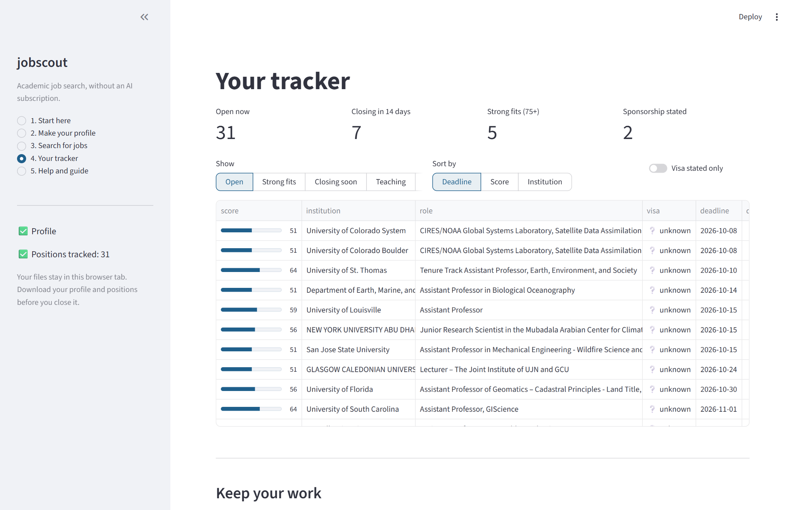

# jobscout

Find **Assistant Professor**, **Teaching Professor**, **Research Faculty** and
**Research Scientist** jobs that fit your CV, and drop the ones that will not sponsor
your visa. Free, with no AI account needed.



## What it does

1. **You make a profile.** A short markdown file listing your field's keywords, the
   role types you want, and whether you need visa sponsorship. Fill in a form, or paste
   the provided prompt and your CV into any free chatbot.
2. **It searches six academic job boards.** Chronicle of Higher Education, Inside
   Higher Ed, Nature Careers, Science Careers, Times Higher Education and AGU, all
   through their public feeds. A search takes about 15 seconds.
3. **It keeps only what fits.** Postdoc, adjunct, administrative and senior-only posts
   are thrown out. Each remaining posting is read for visa wording: *will not sponsor*
   and *US citizens only* are dropped, *sponsorship available* is boosted. What is left
   is scored out of 100 against your profile.
4. **You track it.** Sort by deadline or score, mark what you have applied to, add
   notes, and download a spreadsheet or a standalone tracker page.

Every rule is written down and can be changed. Nothing is decided by an AI unless you
choose to use one.

## Start

**In your browser:** open the web app *(link coming once it is deployed; see
[Publish](docs/05-publish.md))*.

**On your computer** (Python 3.10+):

```bash
git clone https://github.com/SAY70/jobscout
cd jobscout
pip install -e ".[app]"
streamlit run streamlit_app.py
```

**From the command line:**

```bash
pip install "jobscout[all] @ git+https://github.com/SAY70/jobscout"
jobscout init --cv CV.pdf --keywords "remote sensing" "precision agriculture" --sponsorship yes
jobscout scan
jobscout list
```

## Guide

**[Download the full guide (PDF)](docs/jobscout-guide.pdf)**, with screenshots of every
step, or read it page by page:

| | |
|---|---|
| [1 · Start](docs/01-start.md) | Open the app, or install it |
| [2 · Make your profile](docs/02-profile.md) | Three ways to make one, and what every section means |
| [3 · Search](docs/03-search.md) | The boards, the role filters, how visa wording is read, how scoring works |
| [4 · Tracker](docs/04-tracker.md) | Filters, statuses, notes, saving your work |
| [5 · Publish](docs/05-publish.md) | Put the app on the web for free with Streamlit |
| [6 · Command line](docs/06-command-line.md) | Every command, and a free weekly search on GitHub |
| [The profile prompt](docs/profile-prompt.md) | The exact instructions for making a profile with any chatbot |
| [Questions](docs/faq.md) | Common questions |

## Optional: Claude

The first version of jobscout used Claude for everything. That is still available if you
have an Anthropic API key: `jobscout profile CV.pdf` writes the profile, and
`jobscout scan --engine claude` searches the open web rather than six boards (about $1 a
run). In the app, it is under **Make your profile → C**.

## Your data

The web app keeps your CV, profile and positions in your browser session only. Nothing
is written to the server, and nothing is visible to other visitors. On your own computer,
everything is a file you own. The only network traffic is to the job boards, plus
Anthropic if you choose Claude.

## What it will not do

It does not write or send applications. It is not a complete index: HigherEdJobs,
AcademicJobsOnline, LinkedIn and university HR sites do not publish open feeds, so they
are not searched. Visa wording is read by pattern, not understood, so always confirm
sponsorship with the department.

## Development

```bash
pip install -e ".[all]" pytest
python -m pytest tests -q          # no network, no API key
python scripts/build_guide.py      # rebuild docs/jobscout-guide.pdf (needs reportlab)
```

```
streamlit_app.py   the web app
jobscout/
  spec.py          read profile.md into search settings
  builder.py       write profile.md from a form; keyword suggestions from a CV
  feeds.py         the six job boards' RSS feeds, and posting pages
  freescan.py      role-type, visa and deadline rules; scoring; the search
  store.py         the position list, and the merge that keeps your edits
  render.py        the standalone HTML tracker
  cv.py            read a CV from pdf, docx, md, txt or tex
  profile.py       the profile prompt; profile writing with Claude
  scan.py          search with Claude (optional)
  claude.py        Anthropic API wrapper (optional)
  cli.py           the commands
```

## Licence

MIT. See [LICENSE](LICENSE).
